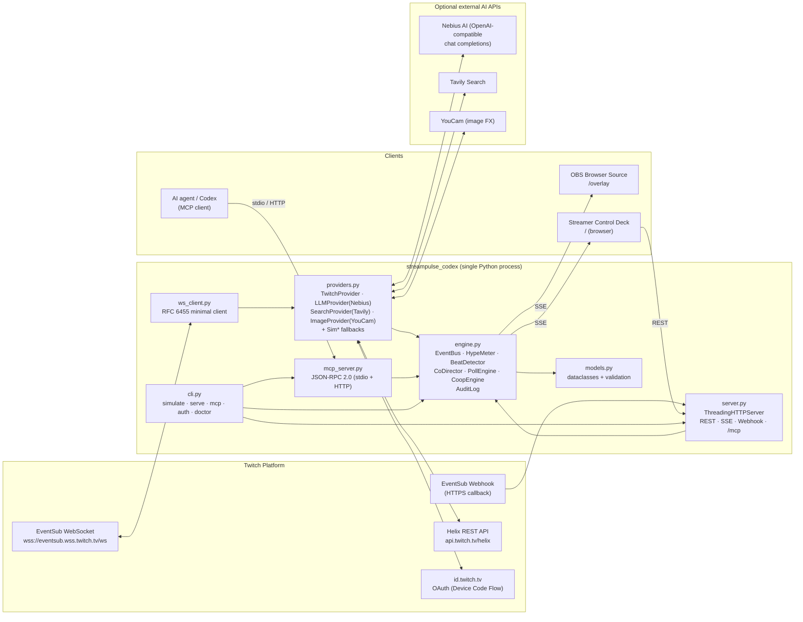

# StreamPulse Codex: Architecture & Implementation Design Specification

**Live Twitch EventSub & Chat Co-Director Built with OpenAI Codex**

| Field | Value |
|---|---|
| Document | `DESIGN_OPUS55.md` |
| Python package | `streampulse_codex` |
| Hackathon | Codex x TwitchCon Hackathon (Devpost challenge 31742) |
| Submission deadline | **2026-11-02 14:00 PT** (see §12.1 on the UTC/JST ambiguity) |
| Target prizes | 1st Place ($10,000 + TwitchCon stage); Audience Participation & Streamer Collaboration themes |
| Author | Kazutoshi Hayashi (`cal29292929`) |
| License | MIT |
| Codex provenance | Built in an OpenAI Codex CLI thread (model `gpt-6-luna`). The session ID is embedded at build time via `CODEX_SESSION_ID` (§9) |
| Runtime | Python ≥ 3.11, **standard library only** for the core. Live integrations are optional |

---

## Table of Contents

1. [Executive Summary & Judging Criteria Alignment](#1-executive-summary--judging-criteria-alignment)
2. [System Architecture](#2-system-architecture)
3. [Multi-Model / API Data Flow & Exact Schemas](#3-multi-model--api-data-flow--exact-schemas)
4. [Dual-Mode Execution (Live vs. Deterministic Simulation)](#4-dual-mode-execution)
5. [Model Context Protocol Server](#5-model-context-protocol-server)
6. [Module-by-Module Specification](#6-module-by-module-specification)
7. [Test Suite Specification](#7-test-suite-specification)
8. [Security, Privacy & Reliability Constraints](#8-security-privacy--reliability-constraints)
9. [Codex Provenance & Session Tracking](#9-codex-provenance--session-tracking)
10. [UX Design: Overlay & Control Deck](#10-ux-design-overlay--control-deck)
11. [Repository Layout & Configuration](#11-repository-layout--configuration)
12. [Delivery Plan, Demo Script & Submission Checklist](#12-delivery-plan-demo-script--submission-checklist)
13. [Appendices](#13-appendices)

---

## 1. Executive Summary & Judging Criteria Alignment

### 1.1 One-paragraph pitch

StreamPulse Codex is an **AI co-director** for live Twitch streams. It listens to chat, Channel Points redemptions, subs, and cheers through **EventSub**, and computes a real-time **Hype Index** for the stream. It then detects "beats" in the stream: a lull, a spike, a sub train, or a cheer bomb. For each beat it proposes the next interactive moment, either a **Chaos Poll** where chat votes on a twist for the streamer or a **Co-op Raid Boss** that chat, and optionally a *second streamer's* chat, defeat together. Every AI proposal goes to the streamer's **Control Deck** for one-click approval before it touches the stream. Approved moments then appear on an **OBS Browser Source overlay**. The entire experience also runs offline in a **seeded, deterministic simulation** in under 5 seconds. AI agents can drive it through an **MCP server**.

### 1.2 Why it is novel

The usual chat tools are each one of these things: a poll widget, a chatbot, an alert box, or a "Twitch Plays" game. StreamPulse combines four ideas that are not usually found together:

1. **Beat-aware direction.** The system decides *when* an interaction should happen based on measured stream momentum, instead of waiting for the streamer to remember to run one.
2. **Human-in-the-loop AI.** The LLM proposes and the streamer disposes. Nothing reaches the stream without approval, unless the streamer has explicitly whitelisted that action class in Autopilot.
3. **Cross-channel co-op.** Two collaborating streamers share one boss HP bar. Each community's contribution is visualized, so collaboration becomes a spectator sport.
4. **Viewer-authored chaos.** A "Chaos Ticket" Channel Points redemption lets a viewer submit a poll option. The option goes through guardrails before it is shown.

### 1.3 Official judging criteria → concrete features

All four official criteria are **equally weighted**. Stage One is a pass/fail check of theme fit and required-tool usage.

| Official criterion | What judges ask | StreamPulse features that answer it | Evidence surfaced in submission |
|---|---|---|---|
| **Stage One gate** | Fits theme? Uses Twitch + Codex? | EventSub (4 subscription types), Helix Chat API, OBS overlay; built in Codex with a tracked session ID | `/api/meta` endpoint, overlay footer badge, `CODEX.md`, README "How Codex built this" |
| **Innovation / Idea** | Creative, novel, different from existing concepts? | Beat detection → AI proposal → streamer approval loop; cross-channel shared boss; viewer-authored, guard-railed Chaos Tickets | Demo segments 0:20–1:40 (§12.3) |
| **Potential Impact** | Useful/entertaining for streamers and communities? | Fixes "dead air" with lull detection; lowers the effort of running interactions to one click; gives small streamers collab tooling; zero-PII design is safe to adopt | Hype Index before/after chart in `artifacts/report.md`; participation-rate metric per moment |
| **Technological Implementation** | Well built? Good use of Codex? | Stdlib-only core; HMAC-verified webhooks; EventSub WebSocket with reconnect; retry/backoff with rate-limit awareness; hash-chained audit log; MCP server; deterministic sim; ~90 unit tests in <5 s | CI badge, `python -m unittest` output in video, `CODEX.md` prompt log |
| **Design** | Easy to use, fun to watch? | Large, legible overlay with animated bars and boss HP; one-screen Control Deck; first run takes one command with no setup | Overlay GIF in README; 3-minute video |

> The task brief lists "Quality of Idea". In the official rules this criterion is named **Innovation/Idea**, and this document uses the official name.

### 1.4 Theme / prize alignment

The hackathon awards prizes by **rank** (1st, 2nd, 3rd, 2 runner-ups), not by track. The "Audience Participation" and "Streamer Collaboration" directions are *suggested themes*. StreamPulse targets both deliberately, so it scores well on Potential Impact and Innovation, which in turn drives the overall rank.

| Theme | Feature | Twitch surface |
|---|---|---|
| Audience Participation | Chaos Poll (`!vote N` / bare digits), Raid Boss (`!hit`, cheers = crits), Chaos Ticket redemptions | `channel.chat.message`, `channel.cheer`, `channel.channel_points_custom_reward_redemption.add` |
| Streamer Collaboration | Linked Session: two broadcasters, one boss, a split contribution meter, and a shared victory screen | Two sets of EventSub subscriptions (one per broadcaster) on one server |
| Content Enhancement (bonus) | Optional Tavily grounding makes poll twists relevant to the current game or category | Helix `GET /channels` (game name) → Tavily search |

---

## 2. System Architecture

### 2.1 Component diagram



### 2.2 ASCII runtime view (for terminals / README)

```
                ┌──────────────── Twitch ─────────────────┐
                │ EventSub WS ─┐   EventSub Webhook ─┐    │
                │ Helix REST ◄─┼──────────────┐      │    │
                └──────────────┼──────────────┼──────┼────┘
                               ▼              │      ▼
┌─────────────────────────── streampulse_codex ─────────────────────────────┐
│ ws_client ─► providers.TwitchProvider ──normalize──► engine.EventBus      │
│                                                       │                   │
│   server.py /eventsub/webhook ─verify HMAC─normalize──┘                   │
│                                                       ▼                   │
│   HypeMeter ─► BeatDetector ─► CoDirector ─(LLM/Search/Sim)─► Suggestion  │
│        │                              ▲                         │         │
│        │                              │                  Control Deck     │
│        ▼                              │                approve/reject     │
│   PollEngine ◄── chat votes ──────────┘                         │         │
│   CoopEngine ◄── !hit / cheers / subs                           ▼         │
│        │                                              Actuator (overlay + │
│        └──────────► StateStore ──► SSE /api/stream ──► chat announce)     │
│   AuditLog (hash-chained, PII-free) ◄── every state transition            │
│   mcp_server ◄─ JSON-RPC 2.0 (stdio | POST /mcp)                          │
└───────────────────────────────────────────────────────────────────────────┘
        ▲ OBS Browser Source /overlay        ▲ Deck /        ▲ MCP client
```

### 2.3 Concurrency model

The core uses only the standard library, so there are no asyncio-framework dependencies. It runs **threads plus a single engine lock**:

| Thread | Responsibility | Blocking I/O |
|---|---|---|
| `main` | `ThreadingHTTPServer.serve_forever()` | HTTP accept |
| `eventsub-ws-<broadcaster>` | Reads WebSocket frames, handles keepalive and reconnect | TLS socket |
| `director-tick` | Runs the engine tick every 1 s: hype decay, beat detection, poll/game timers | `Event.wait(1.0)` |
| `provider-pool` (2 workers, `concurrent.futures.ThreadPoolExecutor`) | LLM, search, and image calls, so the tick never blocks | HTTPS |
| HTTP request threads | REST, SSE (one long-lived thread per SSE client, capped at 16) | socket |

All mutations of `Engine` state happen under `Engine._lock` (`threading.RLock`). SSE broadcast uses a per-client `queue.Queue(maxsize=256)`. If a slow client fills its queue, it is dropped with an `overflow` event rather than blocking the engine.

### 2.4 Event lifecycle (sequence)

```mermaid
sequenceDiagram
  participant TW as Twitch EventSub
  participant PV as TwitchProvider
  participant EN as Engine
  participant CD as CoDirector
  participant LLM as Nebius / SimLLM
  participant DK as Control Deck
  participant OV as OBS Overlay

  TW->>PV: notification (channel.chat.message)
  PV->>PV: dedupe message_id, normalize, hash chatter id
  PV->>EN: StreamEvent(kind=CHAT)
  EN->>EN: HypeMeter.observe(); PollEngine.try_vote()
  EN-->>OV: SSE hype.update / poll.tally
  Note over EN: tick: BeatDetector sees LULL (hype<25 for 45s)
  EN->>CD: plan(snapshot, beat=LULL)
  CD->>LLM: chat.completions (JSON schema)
  LLM-->>CD: {prompt, options[]}
  CD->>CD: guard (schema, blocklist, length, dedupe)
  CD-->>DK: SSE suggestion.new (requires_approval)
  DK->>EN: POST /api/suggestions/{id}/approve
  EN->>EN: PollEngine.open(); AuditLog.append()
  EN-->>OV: SSE poll.open
  EN->>PV: Helix POST /chat/messages ("Vote now: !vote 1-3")
```

---

## 3. Multi-Model / API Data Flow & Exact Schemas

### 3.1 External API inventory

| Provider | Purpose | Auth | Base URL (configurable) | Required? |
|---|---|---|---|---|
| Twitch Helix | Create EventSub subs, send chat, update redemptions, read channel info | `Authorization: Bearer <user token>` + `Client-Id` | `https://api.twitch.tv/helix` | Live mode only |
| Twitch OAuth | Device Code Flow, token refresh, validate | client id (+ secret for confidential apps) | `https://id.twitch.tv/oauth2` | Live mode only |
| Twitch EventSub WS | Event stream | Session-bound (subs created with user token) | `wss://eventsub.wss.twitch.tv/ws` | Live WS mode |
| Twitch EventSub Webhook | Event stream (alt.) | HMAC-SHA256 with `TWITCH_EVENTSUB_SECRET` | Your public HTTPS URL | Live webhook mode |
| Nebius AI | Generate poll prompts, options, and director rationale | `Authorization: Bearer $NEBIUS_API_KEY` | `$NEBIUS_BASE_URL` (OpenAI-compatible `/chat/completions`) | Optional |
| Tavily | Ground twists in the current game or category | `Authorization: Bearer $TAVILY_API_KEY` | `https://api.tavily.com` | Optional |
| YouCam | Stylized boss-portrait art from a **streamer-supplied** image | `Authorization: Bearer $YOUCAM_API_KEY` | `$YOUCAM_BASE_URL` | Optional, cosmetic |

> **Design rule:** every optional provider has a `Sim*` twin that has the same interface and returns schema-identical output. The engine never branches on provider type. It only reads `result.provenance ∈ {"live","sim","fallback"}` for display and audit.

### 3.2 Twitch: OAuth scopes

| Capability | Scope(s) |
|---|---|
| Read chat via EventSub (`channel.chat.message`) | `user:read:chat` (the bot or broadcaster token whose `user_id` is in the condition) |
| Send chat (`POST /chat/messages`) | `user:write:chat` |
| Redemptions read / fulfill | `channel:read:redemptions` / `channel:manage:redemptions` |
| Subscriptions | `channel:read:subscriptions` |
| Cheers | `bits:read` |

`streampulse auth` uses the **Device Code Flow**. There is no redirect server, so judges can authorize from any machine. Tokens are stored in `.streampulse/tokens.json` with file mode `0600`, and that path is listed in `.gitignore`.

### 3.3 Twitch: EventSub subscription creation

**Request** (one per type per broadcaster):

```http
POST https://api.twitch.tv/helix/eventsub/subscriptions
Authorization: Bearer <user_access_token>
Client-Id: <TWITCH_CLIENT_ID>
Content-Type: application/json
```

```json
{
  "type": "channel.chat.message",
  "version": "1",
  "condition": { "broadcaster_user_id": "12345", "user_id": "67890" },
  "transport": { "method": "websocket", "session_id": "AQoQexAWVYKSTIu4ec_2VAxyuhAB" }
}
```

| `type` | `version` | `condition` |
|---|---|---|
| `channel.chat.message` | `1` | `broadcaster_user_id`, `user_id` (reader/bot) |
| `channel.channel_points_custom_reward_redemption.add` | `1` | `broadcaster_user_id` (+ optional `reward_id`) |
| `channel.subscribe` | `1` | `broadcaster_user_id` |
| `channel.cheer` | `1` | `broadcaster_user_id` |

For webhook transport, use `{"method":"webhook","callback":"https://<host>/eventsub/webhook","secret":"<10–100 chars>"}`.

**Response (202 Accepted)**: `data[0].id`, `status`, `cost`, plus top-level `total`, `total_cost`, `max_total_cost`. The provider records `id` for cleanup on shutdown with `DELETE /eventsub/subscriptions?id=`.

### 3.4 Twitch: EventSub WebSocket protocol handling

| `metadata.message_type` | Handling |
|---|---|
| `session_welcome` | Store `payload.session.id` and `keepalive_timeout_seconds`. Create all subscriptions within **10 s**, or Twitch closes the connection. |
| `session_keepalive` | Reset the watchdog. If no message arrives within `keepalive_timeout_seconds + 5`, reconnect. |
| `notification` | Dedupe on `metadata.message_id` (LRU of 4,096 ids), then normalize to a `StreamEvent`. |
| `session_reconnect` | Open a new connection to `payload.session.reconnect_url`. Subscriptions carry over. Close the old connection only after the new connection's `session_welcome` arrives. |
| `revocation` | Log `payload.subscription.status` (e.g., `authorization_revoked`) to the audit trail and surface it on the deck. Do not resubscribe automatically. |

A reconnect after an unexpected close uses exponential backoff with full jitter (base 1 s, cap 30 s) and **creates new subscriptions** on the new session.

### 3.5 Twitch: Webhook verification

Twitch sends these headers: `Twitch-Eventsub-Message-Id`, `Twitch-Eventsub-Message-Timestamp`, `Twitch-Eventsub-Message-Signature`, and `Twitch-Eventsub-Message-Type`.

```python
expected = "sha256=" + hmac.new(secret, (msg_id + timestamp).encode() + raw_body, sha256).hexdigest()
ok = hmac.compare_digest(expected, header_signature)
```

1. Reject with **403** if the signature does not match.
2. Reject with **403** if `|now − timestamp| > 600 s` (replay window).
3. If the message id was already seen, return **204** (idempotent).
4. For `webhook_callback_verification`, respond **200**, `text/plain`, with the body equal to `challenge`.
5. For `notification`, respond **204** immediately and hand the event to the engine asynchronously.
6. For `revocation`, respond **204** and write an audit entry.

### 3.6 Twitch: inbound event payloads (as consumed)

Only the fields listed here are read. **Everything else is discarded at the boundary.**

```jsonc
// channel.chat.message → event
{
  "broadcaster_user_id": "12345",
  "chatter_user_id": "99881", "chatter_user_name": "PixelPal",
  "message_id": "cc106a89-1814-919d-454c-f4f2f970aae7",
  "message": { "text": "!vote 2", "fragments": [ /* ignored */ ] },
  "message_type": "text",
  "badges": [{ "set_id": "subscriber", "id": "6", "info": "6" }]  // only set_id read
}

// channel.channel_points_custom_reward_redemption.add → event
{
  "id": "17fa2df1-ad76-4804-bfa5-a40ef63efe63",
  "broadcaster_user_id": "12345",
  "user_id": "99881", "user_name": "PixelPal",
  "user_input": "streamer must play with inverted controls",
  "status": "unfulfilled",
  "reward": { "id": "92af127c-...", "title": "Chaos Ticket", "cost": 500 },
  "redeemed_at": "2026-10-30T18:42:11.123Z"
}

// channel.subscribe → event
{ "user_id": "99881", "user_name": "PixelPal", "broadcaster_user_id": "12345",
  "tier": "1000", "is_gift": false }

// channel.cheer → event
{ "is_anonymous": false, "user_id": "99881", "user_name": "PixelPal",
  "broadcaster_user_id": "12345", "message": "Cheer100 hit it!", "bits": 100 }
```

### 3.7 Twitch: outbound Helix calls

| Action | Request | Notes |
|---|---|---|
| Announce poll or game | `POST /helix/chat/messages` `{"broadcaster_id","sender_id","message"}` (≤500 chars) | Response `data[0].is_sent`. If `drop_reason` is present, log it and do not retry. |
| Fulfill or refund a Chaos Ticket | `PATCH /helix/channel_points/custom_rewards/redemptions?broadcaster_id=&reward_id=&id=` `{"status":"FULFILLED"\|"CANCELED"}` | This only works for rewards **created by the same Client-Id**. `streampulse setup-rewards` creates them with `POST /custom_rewards`. |
| Read category for grounding | `GET /helix/channels?broadcaster_id=` → `game_name` | Cached for 5 min |

Rate limits: the provider reads `Ratelimit-Remaining` and `Ratelimit-Reset` on every response and pre-emptively sleeps when `remaining < 5`. Outbound chat additionally passes through a local **token bucket of 20 messages / 30 s**. That is the conservative non-moderator limit; it can be raised to 100 if the sender is the broadcaster or a moderator.

### 3.8 Nebius: LLM request/response

**Request** (OpenAI-compatible):

```json
POST {NEBIUS_BASE_URL}/chat/completions
Authorization: Bearer ${NEBIUS_API_KEY}
{
  "model": "${NEBIUS_MODEL}",
  "temperature": 0.7,
  "max_tokens": 300,
  "response_format": { "type": "json_object" },
  "messages": [
    { "role": "system", "content": "<DIRECTOR_SYSTEM_PROMPT v3 — see §13.2>" },
    { "role": "user", "content": "{\"beat\":\"LULL\",\"category\":\"Celeste\",\"hype\":18.4,\"recent_terms\":[\"strawberry\",\"dash\"],\"grounding\":[\"Chapter 7 summit…\"],\"constraints\":{\"options\":[2,4],\"max_chars\":60}}" }
  ]
}
```

**Expected content** (validated against `DirectorPlan` in `models.py`):

```json
{
  "action": "start_poll",
  "rationale": "Chat velocity fell 70% over 45s; a choice about the next screen re-engages lurkers.",
  "poll": {
    "prompt": "Next screen: how does the streamer play it?",
    "options": ["No dashing", "Eyes closed for 5s", "Speedrun pace", "Chat picks the route"],
    "duration_s": 60
  },
  "confidence": 0.78
}
```

If the response fails JSON parsing, schema validation, or the guard (§8.4), the provider retries **once** with a "repair" message. If that also fails, the **SimLLM template bank** answers and `provenance = "fallback"`.

### 3.9 Tavily: grounding request/response

```json
POST https://api.tavily.com/search
Authorization: Bearer ${TAVILY_API_KEY}
{ "query": "Celeste speedrun challenge ideas", "max_results": 3, "search_depth": "basic",
  "include_answer": false }
```

The provider reads only `results[].title` and `results[].content`, truncated to 280 characters each. URLs are kept for the audit trail but **never** shown on the overlay. The query is built from `game_name` plus the beat type only. **No chat text is ever sent to Tavily.**

### 3.10 YouCam: optional cosmetic image FX

YouCam is used only to stylize a **streamer-uploaded** boss portrait (`assets/boss/*.png`) into a themed variant before a Raid Boss starts. The adapter is `ImageProvider.stylize(image_bytes, style) -> ImageResult(png_bytes, provenance)`. The endpoint path and payload are set by `YOUCAM_BASE_URL` / `YOUCAM_STYLE_ENDPOINT` so the adapter can follow YouCam's current API contract without code changes. `SimImage` applies a deterministic palette shift and outline using pure-Python PNG re-encoding (`zlib` + `struct`).

> **Hard constraint:** viewer-supplied images and webcam frames are never sent to any image API.

### 3.11 Internal REST API (served by `server.py`)

All JSON responses use the envelope `{"ok": true, "data": ...}` or `{"ok": false, "error": {"code": "...", "message": "..."}}`.

| Method & path | Auth | Request body | Response `data` |
|---|---|---|---|
| `GET /healthz` | none | – | `{"status":"ok","mode":"sim\|live","uptime_s":12.3}` |
| `GET /api/meta` | none | – | `RunManifest` (§6.2) incl. `codex_session_id` |
| `GET /api/state` | deck or overlay | – | `EngineState` snapshot |
| `GET /api/stream` | deck or overlay (query `token`) | – | `text/event-stream` (§3.12) |
| `POST /api/polls` | deck | `{"prompt","options":[...],"duration_s"}` | `ChaosPoll` |
| `POST /api/polls/{id}/close` | deck | – | `PollResult` |
| `POST /api/games` | deck | `{"kind":"raid_boss","max_hp":5000,"linked_broadcasters":["12345","54321"]}` | `CoopGame` |
| `POST /api/suggestions/{id}/approve` | deck | `{"edits":{...}}` (optional) | `ChaosPoll \| CoopGame` |
| `POST /api/suggestions/{id}/reject` | deck | `{"reason":"..."}` | `DirectorSuggestion` |
| `POST /api/autopilot` | deck | `{"enabled":true,"allow":["start_poll"]}` | `AutopilotConfig` |
| `POST /api/simulate` | deck | `{"seed":42,"duration_s":120,"speed":0}` | `SimulationReport` |
| `GET /api/audit?since=<seq>` | deck | – | `AuditEntry[]` |
| `POST /eventsub/webhook` | HMAC | raw Twitch body | 200 challenge / 204 |
| `POST /mcp` | deck (Bearer) | JSON-RPC 2.0 | JSON-RPC 2.0 |

Tokens: `DECK_TOKEN` (full control) and `OVERLAY_TOKEN` (read-only). Both are generated with `secrets.token_urlsafe(24)` on first run if absent, printed once, and stored in `.streampulse/tokens.json`.

### 3.12 SSE event schema (overlay & deck)

```
event: hype.update
id: 1842
data: {"ts":"2026-10-30T18:42:12Z","hype":63.2,"chat_per_min":148,"sentiment":0.41,"beat":"SPIKE"}

event: poll.open      data: {"poll_id":"p_7f3a","prompt":"...","options":[{"idx":1,"label":"..."}],"closes_at":"..."}
event: poll.tally     data: {"poll_id":"p_7f3a","counts":[12,40,7],"total":59}
event: poll.close     data: {"poll_id":"p_7f3a","winner_idx":2,"counts":[...],"participation":0.31}
event: game.update    data: {"game_id":"g_19","hp":3120,"max_hp":5000,"by_channel":{"12345":1240,"54321":640},"last_hit":{"display":"PixelPal","dmg":100,"crit":true}}
event: game.end       data: {"game_id":"g_19","result":"victory","mvp_display":"PixelPal","duration_s":94}
event: suggestion.new data: DirectorSuggestion        (deck only)
event: alert          data: {"kind":"sub|cheer|redemption","display":"PixelPal","detail":"Tier 1"}
event: system         data: {"level":"warn","message":"EventSub reconnecting"}
```

The `id` field is a monotonically increasing sequence number. A reconnecting client sends `Last-Event-ID`, and the server replays events from a 512-entry ring buffer.

---

## 4. Dual-Mode Execution

### 4.1 Mode resolution

```python
def resolve_mode(env: Mapping[str, str]) -> ModeConfig:
    forced = env.get("STREAMPULSE_MODE")          # "live" | "sim" | None
    twitch_ready = all(env.get(k) for k in ("TWITCH_CLIENT_ID",)) and token_store_has_user_token()
    return ModeConfig(
        twitch="live" if (forced != "sim" and twitch_ready) else "sim",
        llm   ="live" if (forced != "sim" and env.get("NEBIUS_API_KEY")) else "sim",
        search="live" if (forced != "sim" and env.get("TAVILY_API_KEY")) else "sim",
        image ="live" if (forced != "sim" and env.get("YOUCAM_API_KEY")) else "sim",
    )
```

Each provider is selected **independently**. A judge can therefore connect real Twitch while the LLM runs in simulation, or the reverse. The Control Deck header shows four chips, `Twitch · LLM · Search · Image`, each colored live (green), sim (blue), or fallback (amber).

### 4.2 Mode (A): Live

* Twitch events arrive through EventSub WebSocket (default) or Webhook (`STREAMPULSE_TRANSPORT=webhook`; this needs a public HTTPS URL such as a tunnel).
* LLM, search, and image calls go through `HttpTransport` with timeout, retry, and auth (§6.3).
* Any live failure **degrades per call** to the simulation twin. It never crashes the stream. Each degradation is logged in the audit trail as `provider.fallback`.

### 4.3 Mode (B): High-fidelity deterministic simulation

The goal is for `python -m streampulse_codex.cli simulate --seed 42` to run a full 10-minute stream arc in **under 5 s wall time** with zero network access, and to produce byte-identical artifacts on every run.

| Mechanism | Detail |
|---|---|
| **Virtual clock** | `SimClock` implements the `Clock` protocol (`now()`, `sleep()`). In sim, `sleep` advances virtual time instantly, and engine ticks run as a tight loop. |
| **Seeded RNG** | A single `random.Random(seed)` is split into sub-streams (`rng_chat`, `rng_votes`, `rng_llm`) by deriving seeds with `sha256(f"{seed}:{name}")`. Each subsystem is therefore deterministic independently of call ordering in the others. |
| **Persona population** | 400 synthetic chatters (`viewer_0001`…), with Zipf-distributed activity (s = 1.2), 12% subscribers, 3% bit-cheerers, and per-persona vote bias. Display names come from a fixed adjective-noun word list. They are not real users. |
| **Stream arc script** | Phases with arrival-rate multipliers: `warmup(60s,0.6)` → `gameplay(120s,1.0)` → `lull(60s,0.25)` → `hype_moment(45s,3.5)` → `sub_train(40s,2.0)` → `collab_raid(120s,2.2)` → `cooldown(60s,0.7)`. Chat arrivals are Poisson with base λ = 2.4 msg/s. |
| **Realistic payloads** | Sim events are built by `sim_fixtures.py` in the **exact Twitch EventSub JSON shape** (§3.6). They pass through the *same* normalizer as live events, so the sim exercises the real code path. |
| **SimLLM** | A template bank of 60 prompt/option sets keyed by `(beat, category_tag)`. The choice uses `rng_llm`, and output is schema-identical to Nebius. |
| **SimSearch** | 24 canned grounding snippets per demo category. |
| **Linked channel** | The sim spawns a second broadcaster (`sim_partner`) with its own persona pool, which exercises Streamer Collaboration. |
| **Reproducibility proof** | `artifacts/run_manifest.json` includes `artifact_digest = sha256(canonical_json(events_summary + polls + games + audit_hashes))`. A test asserts that two runs with the same seed produce the same digest. |

Wall-time budget (target on a 2023 laptop):

| Stage | Budget |
|---|---|
| Import + config | 0.15 s |
| Generate ≈ 9,000 sim events (10 min arc, ×2 channels) | 0.9 s |
| Engine processing (hype, beats, polls, games, audit) | 1.6 s |
| Artifact writing (JSON + Markdown + SVG sparkline) | 0.2 s |
| **Total** | **≈ 2.9 s (hard CI limit: 5.0 s)** |

### 4.4 Demo mode for judges

`python -m streampulse_codex.cli serve --demo` starts the server in sim mode. The simulated stream runs at **real-time speed** (`speed=1`) so it is watchable, and the default browser opens the Control Deck. The overlay URL, including its token, is printed to paste into OBS. No Twitch account is needed.

---

## 5. Model Context Protocol Server

### 5.1 Transports

| Transport | Invocation | Framing |
|---|---|---|
| stdio | `python -m streampulse_codex.mcp_server` (or `cli mcp`) | One JSON-RPC message per line (UTF-8, `\n`-delimited). Logs go to **stderr only**. |
| HTTP | `POST /mcp` on the main server | `Content-Type: application/json`, single message or batch, `Authorization: Bearer <DECK_TOKEN>` |

Example Codex CLI configuration (`~/.codex/config.toml`):

```toml
[mcp_servers.streampulse]
command = "python"
args = ["-m", "streampulse_codex.mcp_server", "--mode", "sim", "--seed", "42"]
```

### 5.2 Lifecycle

| Method | Behaviour |
|---|---|
| `initialize` | Returns `{"protocolVersion": <negotiated, default "2025-06-18">, "capabilities": {"tools": {"listChanged": false}}, "serverInfo": {"name":"streampulse-codex","version":"1.0.0"}}`. If the client requests a version the server doesn't know, the server answers with its own latest supported version. |
| `notifications/initialized` | No response (notification). |
| `ping` | `{}` |
| `tools/list` | Tool descriptors (§5.3) |
| `tools/call` | `{"content":[{"type":"text","text":"<json>"}],"structuredContent":{...},"isError":false}` |

Error codes: `-32700` parse error, `-32600` invalid request, `-32601` method not found, `-32602` invalid params (schema violations, with a field path in `data`), `-32603` internal error. Domain failures, such as a poll already open, are returned as **tool results** with `isError: true`, not as protocol errors, so agents can reason about them.

### 5.3 Tool catalogue (6 tools)

| Tool | Purpose | `inputSchema` (abridged) | Side effect |
|---|---|---|---|
| `get_stream_pulse` | Current Hype Index, beat, velocity, sentiment, top terms | `{"window_s": {"type":"integer","minimum":10,"maximum":600,"default":60}}` | none |
| `propose_moment` | Run the Co-Director pipeline and return a pending suggestion | `{"beat_hint": {"enum":["AUTO","LULL","SPIKE","SUB_TRAIN","CHEER_BOMB"]}}` | creates a **pending** suggestion; nothing goes on stream |
| `start_chaos_poll` | Open a poll | `{"prompt":{"type":"string","maxLength":120},"options":{"type":"array","minItems":2,"maxItems":5,"items":{"type":"string","maxLength":60}},"duration_s":{"type":"integer","minimum":15,"maximum":300}}` | **Requires `approval: "streamer"` unless Autopilot allows `start_poll`.** Otherwise returns a pending suggestion. |
| `start_coop_game` | Start a Raid Boss (optionally linked) | `{"max_hp":{"type":"integer","minimum":100,"maximum":100000},"linked_broadcasters":{"type":"array","maxItems":2}}` | same approval rule |
| `ingest_event` | Inject a Twitch-shaped event (sim / testing only) | `{"subscription_type":{...enum of 4},"event":{"type":"object"}}` | **Disabled in live Twitch mode** (`isError: true`) |
| `get_audit_trail` | Read the hash-chained audit log and verify the chain | `{"since_seq":{"type":"integer","minimum":0},"verify":{"type":"boolean"}}` | none |

**Agent safety principle:** MCP tools carry the *same* approval gate as the LLM Co-Director. An external agent cannot put content on a live stream that the streamer didn't approve.

### 5.4 Example exchange

```json
→ {"jsonrpc":"2.0","id":3,"method":"tools/call","params":{"name":"get_stream_pulse","arguments":{"window_s":60}}}
← {"jsonrpc":"2.0","id":3,"result":{
     "content":[{"type":"text","text":"{\"hype\":63.2,\"beat\":\"SPIKE\",...}"}],
     "structuredContent":{"hype":63.2,"beat":"SPIKE","chat_per_min":148,"sentiment":0.41,
                          "top_terms":["boss","clutch","gg"],"provenance":"sim"},
     "isError":false}}
```

---

## 6. Module-by-Module Specification

### 6.1 `streampulse_codex/__init__.py`

```python
"""StreamPulse Codex — live Twitch EventSub & chat co-director built with OpenAI Codex."""
__version__ = "1.0.0"
__author__ = "Kazutoshi Hayashi (cal29292929)"
__license__ = "MIT"

from .models import StreamEvent, ChaosPoll, CoopGame, DirectorSuggestion, HypeSnapshot, AuditEntry
from .engine import Engine, build_engine

__all__ = [...]
```

* No side effects at import time: no env reads, no I/O.
* `build_engine(mode: ModeConfig | None = None, *, seed: int = 42, clock: Clock | None = None) -> Engine` is the single composition root. Tests, the CLI, the server, and MCP all use it.

### 6.2 `streampulse_codex/models.py`

These are pure dataclasses (`@dataclass(frozen=True, slots=True)` where immutable) with strict validation in `__post_init__`. Each class provides `to_dict()` and `from_dict()` for JSON round-tripping. Validation failures raise `ValidationError(field, message)`.

| Model | Key fields | Validation |
|---|---|---|
| `EventKind(StrEnum)` | `CHAT, REDEMPTION, SUBSCRIBE, CHEER, SYSTEM` | – |
| `StreamEvent` | `event_id: str`, `kind`, `broadcaster_id: str`, `actor_hash: str`, `actor_display: str \| None`, `occurred_at: datetime (UTC)`, `text: str = ""`, `bits: int = 0`, `tier: int = 0`, `reward_title: str = ""`, `reward_cost: int = 0`, `user_input: str = ""`, `source: Literal["eventsub_ws","webhook","sim","mcp"]` | `broadcaster_id` numeric string ≤ 20; `text` ≤ 500 chars after NFC normalization and control-character stripping; `bits` 0–1,000,000; `tier ∈ {0,1,2,3}`; `occurred_at` tz-aware |
| `PollOption` | `idx: int`, `label: str`, `author: Literal["director","streamer","viewer"]` | label 1–60 chars, guard-passed |
| `ChaosPoll` | `poll_id`, `prompt`, `options: tuple[PollOption,...]`, `opened_at`, `duration_s`, `status: open/closed`, `counts: list[int]`, `_voters: set[str]` (excluded from serialization) | 2–5 options, unique case-folded labels, 15–300 s |
| `PollResult` | `poll_id`, `winner_idx`, `counts`, `total_votes`, `participation: float` (votes ÷ unique chatters in the window) | ties are broken by earliest option index, which keeps results deterministic |
| `CoopGame` | `game_id`, `kind="raid_boss"`, `max_hp`, `hp`, `by_channel: dict[str,int]`, `phase: lobby/active/victory/timeout`, `deadline` | `hp` clamped to `[0, max_hp]`; ≤ 2 linked broadcasters |
| `HypeSnapshot` | `ts`, `hype: float [0,100]`, `chat_per_min`, `events_per_min`, `sentiment: float [-1,1]`, `beat: Beat`, `top_terms: tuple[str,...]` | terms must satisfy the k-anonymity threshold (§8.3) |
| `Beat(StrEnum)` | `STEADY, LULL, SPIKE, SUB_TRAIN, CHEER_BOMB` | – |
| `DirectorPlan` | `action: start_poll/start_game/none`, `rationale ≤ 240`, `poll?`, `game?`, `confidence [0,1]` | the matching sub-object must be present for the action |
| `DirectorSuggestion` | `suggestion_id`, `beat`, `plan`, `provenance`, `created_at`, `status: pending/approved/rejected/expired`, `requires_approval: bool` | expires after 120 s |
| `AuditEntry` | `seq`, `ts`, `actor: system/streamer/agent/mcp/twitch`, `action`, `subject_id`, `inputs_digest`, `outcome`, `prev_hash`, `hash` | `hash = sha256(prev_hash ‖ canonical_json(entry_without_hash))` |
| `RunManifest` | `app_version`, `codex_session_id`, `codex_model`, `mode`, `seed`, `python`, `started_at`, `artifact_digest` | `codex_session_id` must match `^[A-Za-z0-9._:-]{6,128}$` or be `"unset"` |

Serialization helper: `canonical_json(obj) = json.dumps(obj, sort_keys=True, separators=(",",":"), ensure_ascii=False, default=_encode)`. Datetimes are encoded as RFC 3339 `Z`. It is used for hashing, digests, and artifacts.

### 6.3 `streampulse_codex/providers.py`

#### 6.3.1 Transport layer

```python
class HttpTransport(Protocol):
    def request(self, method: str, url: str, *, headers: dict, body: bytes | None,
                timeout: float) -> HttpResponse: ...

class UrllibTransport:   # stdlib urllib.request + ssl.create_default_context()
class FakeTransport:     # tests: scripted responses, records calls
```

#### 6.3.2 `ApiClient`: retry, timeout, auth

| Concern | Policy |
|---|---|
| Timeouts | connect + read = `STREAMPULSE_HTTP_TIMEOUT` (default 8 s for LLM, 4 s for Twitch and search) |
| Retry | Up to **3 attempts**, only for `429`, `500`, `502`, `503`, `504`, `URLError`, and `TimeoutError`. Never retries other 4xx. |
| Backoff | Full jitter: `sleep = rng.uniform(0, min(cap, base·2^attempt))` with base 0.5 s and cap 8 s. `Retry-After` (seconds or HTTP-date) and Twitch `Ratelimit-Reset` take precedence. |
| Idempotency | Only GETs and explicitly idempotent POSTs (LLM, search) are retried. `POST /chat/messages` is **not retried** after a timeout, to avoid duplicate chat. |
| Bearer auth | `Authorization: Bearer <token>`, plus `Client-Id` for Helix. On 401 from Helix, refresh the token once via `refresh_token` and replay. |
| HMAC auth | `verify_eventsub_signature(secret, msg_id, ts, body, sig) -> bool` (inbound), using constant-time compare |
| Secret hygiene | `Secret` wrapper type whose `__repr__` returns `Secret('***')`. Headers are redacted in all logs. |
| Circuit breaker | 5 consecutive failures → open for 60 s → calls go directly to the sim twin (`provenance="fallback"`) |

#### 6.3.3 Providers and their sim twins

| Interface | Live impl | Sim impl | Methods |
|---|---|---|---|
| `TwitchProvider` | `HelixTwitch` (+ `EventSubWsClient`, webhook handler) | `SimTwitch` (drives `sim_fixtures`) | `start(on_event)`, `stop()`, `send_chat(text)`, `update_redemption(r, status)`, `get_category()` |
| `LLMProvider` | `NebiusLLM` | `SimLLM` | `plan(context: DirectorContext) -> ProviderResult[DirectorPlan]` |
| `SearchProvider` | `TavilySearch` | `SimSearch` | `ground(query: str) -> ProviderResult[list[Snippet]]` |
| `ImageProvider` | `YouCamImage` | `SimImage` | `stylize(png: bytes, style: str) -> ProviderResult[bytes]` |

`ProviderResult[T] = (value: T, provenance: Literal["live","sim","fallback"], latency_ms: int, error: str | None)`

`normalize_eventsub(subscription_type: str, event: dict, *, source, salt) -> StreamEvent` is the **only** place raw Twitch JSON is read. Live and sim share it.

### 6.4 `streampulse_codex/ws_client.py` (supporting module)

This is a minimal RFC 6455 client so the core stays stdlib-only, in about 200 lines. Its scope:

* TLS via `ssl.create_default_context()` and HTTP/1.1 Upgrade with `Sec-WebSocket-Key`, plus verification of `Sec-WebSocket-Accept`.
* Client-to-server frames are masked. Supported opcodes are text, ping→pong, and close. Fragmented frames are reassembled, with a 1 MiB message limit.
* `recv(timeout)` raises `WsTimeout`, which the keepalive watchdog uses.
* If the `websockets` package is installed and `STREAMPULSE_WS_IMPL=websockets` is set, it is used instead. This is optional and not required.

### 6.5 `streampulse_codex/engine.py`

#### 6.5.1 Components

| Component | Responsibility |
|---|---|
| `EventBus` | Fan-out of `StreamEvent` to subscribers. Handlers are synchronous and run under the engine lock. |
| `HypeMeter` | Quantitative momentum metrics (§6.5.2) |
| `BeatDetector` | A state machine over `HypeSnapshot` history that emits a `Beat` with hysteresis |
| `PollEngine` | Opens, tallies, and closes Chaos Polls; one vote per `actor_hash`, changeable until close |
| `CoopEngine` | Raid Boss damage model, linked channels, timeout |
| `CoDirector` | The multi-step agentic workflow (§6.5.3) |
| `Actuator` | Applies approved plans: engine state, SSE broadcast, optional chat announcement |
| `AuditLog` | Append-only, hash-chained, PII-free |
| `StateStore` | Immutable `EngineState` snapshots for `/api/state` and MCP |

#### 6.5.2 Quantitative metrics

**Event energy weights** (constants in `engine.WEIGHTS`, tunable via config):

| Event | Energy |
|---|---|
| chat message | `1.0` (+0.5 if it contains an emote-only fragment or `!` command) |
| cheer | `1.0 + bits / 100` |
| subscribe | `{1: 8, 2: 16, 3: 40}[tier]` (gift subs ×0.75 each) |
| redemption | `2.0 + cost / 1000` |

**Hype Index.** An exponentially decaying energy integral with half-life `H = 30 s`:

```
E(t) = E(t_prev) · 2^(−(t − t_prev)/H) + w_event
hype(t) = 100 · (1 − exp(−E(t) / K))        K = calibrated per channel (default 40)
```

`K` auto-calibrates during the first 5 minutes to the channel's 75th-percentile energy, so a 20-viewer stream and a 20,000-viewer stream both use the full 0–100 range. This keeps the metric useful for small streamers.

**Chat velocity.** Messages in a sliding 60 s window, implemented as a deque of timestamps.

**Sentiment.** A deterministic lexicon score in `[-1, 1]` (≈ 600 gaming/Twitch-specific terms and emote names, including `PogChamp`, `LUL`, and `KEKW`). The per-message score is averaged with EWMA α = 0.1. No LLM is used here, so the metric is cheap, deterministic, and private.

**Top terms.** Count-min-sketch-free exact counts within the window. Stop words are removed, and only terms used by **≥ 5 distinct chatters** are kept, which provides k-anonymity.

**Beat rules** (with 20 s hysteresis and a 90 s cool-down between director proposals):

| Beat | Trigger |
|---|---|
| `LULL` | `hype < 25` for ≥ 45 s **and** no poll or game active |
| `SPIKE` | `hype − hype_60s_ago ≥ 30` |
| `SUB_TRAIN` | ≥ 3 subscribe events within 60 s |
| `CHEER_BOMB` | ≥ 500 bits within 30 s |
| `STEADY` | otherwise |

**Moment KPIs** (written to the report):

* `participation = unique voters or hitters ÷ unique chatters active in the 5 min before the moment`
* `lift = mean hype for 60 s after the moment − mean hype for 60 s before`
* `time_to_decision_s`: from suggestion to approval (streamer friction metric)

#### 6.5.3 Co-Director agentic workflow

```
OBSERVE → DETECT → GROUND → GENERATE → GUARD → PROPOSE → (APPROVE) → ACTUATE → REFLECT
```

| Step | Implementation | Failure behaviour |
|---|---|---|
| 1. Observe | Build `DirectorContext` from the last 60 s `HypeSnapshot`, category, active moments, and the last 3 moment KPIs | – |
| 2. Detect | `BeatDetector.current()`; stop unless the beat is not `STEADY` and the cool-down has elapsed | – |
| 3. Ground | `SearchProvider.ground(f"{category} {beat.flavor} challenge ideas")`, top 3 snippets | Proceed ungrounded |
| 4. Generate | `LLMProvider.plan(context)` → `DirectorPlan` | Repair once, then `SimLLM` fallback |
| 5. Guard | Schema, blocklist, length, duplicate check against the last 10 prompts (Jaccard ≥ 0.6 counts as a duplicate), and no @mentions or URLs | Discard and use the next template |
| 6. Propose | Create a `DirectorSuggestion` and send SSE to the deck with a 120 s expiry | – |
| 7. Approve | Streamer clicks Approve (optionally editing first) or Reject. Autopilot auto-approves only allowed action classes. | On expiry, `status=expired` |
| 8. Actuate | `Actuator.apply(plan)`: open the poll or game, broadcast via SSE, and announce in chat (rate-limited) | Chat failure doesn't block the overlay |
| 9. Reflect | On close, compute KPIs and store them in the context for the next plan, so the LLM can see what worked | – |

The beat also maps to a default action. LULL → poll (re-engagement). SPIKE → poll ("ride the wave"). SUB_TRAIN → raid boss with sub heals. CHEER_BOMB → raid boss with cheer crits. The LLM may override this default with a rationale.

#### 6.5.4 Chaos Poll mechanics

* Vote syntax accepts `!vote N`, `!v N`, a bare `N` (1–5), or the exact label for options with ≤ 12 characters.
* Each `actor_hash` has one vote, and the latest vote wins. The voter set lives only in memory and is cleared when the poll closes.
* There are optional **weighted votes**: when a streamer enables it, subs and cheerers count ×2. The default is off, for fairness.
* **Chaos Ticket integration.** A redemption's `user_input` goes through the guard. If it passes and a poll is pending approval, it is offered to the streamer as a viewer-authored option. The overlay credits it as "submitted by a viewer" by default; showing the display name is opt-in.
  * If the ticket is accepted, the redemption is `FULFILLED`.
  * If the ticket is rejected or fails the guard, the redemption is `CANCELED`, which refunds the points.

#### 6.5.5 Co-op Raid Boss mechanics

| Input | Effect |
|---|---|
| `!hit` (once per 5 s per chatter) | `dmg = 10 + rng(0..5)` |
| cheer | `dmg = bits`; a cheer of ≥ 100 bits counts as a critical hit and triggers a shake animation |
| subscribe | Raises the team damage multiplier: `+0.25` per sub for 30 s, capped at ×3 |
| redemption "Boss Spawn" | Starts the game, if the streamer has armed it |
| Timer | Default 120 s. If the boss survives, `phase=timeout` and the result is "boss escapes" with a taunt. |

**Linked Session (Streamer Collaboration).** One server holds tokens for two broadcasters, each authorized separately through Device Code Flow. It creates EventSub subscriptions per broadcaster. `CoopGame.by_channel` accumulates damage per channel. Both streamers add the same overlay URL in OBS, and the overlay shows a two-color HP bar with each community's percentage contribution.

Fairness normalization: when `normalize_by_size=true`, damage is scaled by `1 / sqrt(active_chatters_channel)`. This lets a small streamer's community matter in a collab with a large one.

#### 6.5.6 Audit trail

Every state transition appends an `AuditEntry`. Examples: event ingest (aggregated per tick, not per message), suggestion created, approved, or rejected; poll opened or closed; provider fallback; EventSub revocation; and MCP tool calls.

* `inputs_digest` is a SHA-256 of the canonicalized inputs **after** PII removal.
* `AuditLog.verify() -> (ok: bool, first_bad_seq: int | None)`.
* The log is written to `artifacts/audit.jsonl` in CLI runs, and kept in memory with a 10,000-entry cap in server mode.

### 6.6 `streampulse_codex/mcp_server.py`

* `class McpServer(engine: Engine)` exposes `handle(message: dict | list) -> dict | list | None`, which is transport-agnostic.
* `run_stdio(stdin, stdout)` reads lines, decodes JSON (parse errors → `-32700` with `id: null`), dispatches, and writes one line per response. Notifications produce no output.
* Tool argument validation uses a compact built-in JSON-Schema subset validator (`type`, `enum`, `minimum`/`maximum`, `minLength`/`maxLength`, `minItems`/`maxItems`, `required`, `additionalProperties: false`). It returns `-32602` with `data: {"path": "options[2]", "reason": "maxLength 60"}`.
* Each tool call is audited with `actor="mcp"`.
* Entry point: `python -m streampulse_codex.mcp_server [--mode sim|live] [--seed N]`.

### 6.7 `streampulse_codex/server.py`

* `http.server.ThreadingHTTPServer` with a custom `BaseHTTPRequestHandler`, routing through a small regex table.
* By default it binds to **`127.0.0.1:8765`**. Binding `0.0.0.0` requires the `--public` flag and prints a warning.
* Static assets are embedded as Python string constants (`_DECK_HTML`, `_OVERLAY_HTML`, `_APP_JS`, `_STYLE_CSS`), so the server works from a single wheel without package data. `assets/` holds optional sounds and boss art.
* Security headers on every response:
  * `Content-Security-Policy: default-src 'self'; script-src 'self'; style-src 'self' 'unsafe-inline'; img-src 'self' data:; connect-src 'self'; frame-ancestors 'none'`
  * `X-Content-Type-Options: nosniff`, `Referrer-Policy: no-referrer`, `Cache-Control: no-store` on `/api/*`.
* Request limits: body ≤ 64 KiB (webhook ≤ 256 KiB); JSON depth ≤ 20; 10 s read timeout.
* Local per-IP rate limit: 30 req/s token bucket on `/api/*`, returning 429 with `Retry-After`.
* SSE handler: `text/event-stream`, a `: keepalive` comment every 15 s, `Last-Event-ID` replay, and at most 16 concurrent streams.
* The UI is described in §10. Front-end code is vanilla ES2020 with no build step. **All dynamic text is rendered with `textContent`**, never `innerHTML`.

### 6.8 `streampulse_codex/cli.py`

`python -m streampulse_codex.cli <command>`. A console script `streampulse` is also declared in `pyproject.toml`.

| Command | Description | Key flags |
|---|---|---|
| `simulate` | Headless deterministic run; writes artifacts | `--seed 42 --duration 600 --linked --out artifacts/` |
| `serve` | HTTP server plus engine | `--demo`, `--port 8765`, `--public`, `--transport ws\|webhook` |
| `mcp` | MCP stdio server | `--mode`, `--seed` |
| `auth` | Twitch Device Code Flow for broadcaster/bot; `--partner` for the linked collaborator | `--scopes` |
| `setup-rewards` | Creates the "Chaos Ticket" and "Boss Spawn" custom rewards via Helix | `--cost 500` |
| `doctor` | Checks env, token validity (`GET /oauth2/validate`), connectivity, and clock skew; prints mode chips | – |
| `verify-audit` | Verifies the hash chain of an `audit.jsonl` | `path` |

**Artifacts** written by `simulate`:

| File | Content |
|---|---|
| `artifacts/run_manifest.json` | `RunManifest`, including `codex_session_id` and `artifact_digest` |
| `artifacts/summary.json` | Aggregate metrics, polls, games, and KPIs (no per-message data) |
| `artifacts/report.md` | Human-readable stream recap: timeline table, hype sparkline (Unicode blocks), moment KPIs, provider provenance |
| `artifacts/hype.svg` | Hype Index chart (hand-built SVG) for the README and Devpost gallery |
| `artifacts/audit.jsonl` | Hash-chained audit log |

Exit codes: `0` success, `2` usage error, `3` config error, `4` audit verification failure.

---

## 7. Test Suite Specification

**Framework:** stdlib `unittest`. **Command:** `python -m unittest discover -s tests -v`. **Constraints:** no network access, so `UrllibTransport` is patched to raise if touched; total runtime under 5 s; and the suite is deterministic.

| File | Coverage | Representative cases |
|---|---|---|
| `tests/test_models.py` | validation, round-trip | Rejects 1 or 6 poll options; strips control characters; rejects naive datetimes; `from_dict(to_dict(x)) == x`; canonical JSON is stable |
| `tests/test_providers.py` | transport, retry, auth, fallback | 429 with `Retry-After: 2` → waits 2 s (on `SimClock`) and then succeeds; 400 → no retry; chat POST not retried after a timeout; 401 → one refresh then replay; the circuit opens after 5 failures; missing env → sim provider selected; `Secret` repr is redacted |
| `tests/test_eventsub.py` | normalization & protocol | All 4 payload types normalize; unknown fields are dropped; duplicate `message_id` is ignored; welcome→subscribe within budget; `session_reconnect` swaps connections only after the new welcome; keepalive timeout triggers reconnect |
| `tests/test_security.py` | HMAC, replay, XSS, PII | Valid signature is accepted; tampered body is rejected; timestamp 11 minutes old is rejected; `<script>` in chat is escaped in SSE JSON and rendered via `textContent` (asserted by grepping the embedded JS for `innerHTML` = 0 occurrences); no raw `chatter_user_id` appears in audit, artifacts, or summary; blocklisted Chaos Ticket → `CANCELED`; oversize body → 413 |
| `tests/test_engine.py` | metrics & workflow | Hype decays to half in 30 s; K-calibration bounds; LULL fires after 45 s and not before; cool-down respected; one vote per chatter and changing a vote moves the count; tie-break is deterministic; boss HP clamps at 0; linked damage split is correct; suggestion expires at 120 s; Autopilot respects its allow-list |
| `tests/test_audit.py` | hash chain | Chain verifies; editing entry *n* makes `verify()` report `first_bad_seq == n` |
| `tests/test_determinism.py` | reproducibility & perf | Two `simulate(seed=42)` runs produce equal `artifact_digest`; `seed=43` differs; full 600 s linked run completes in < 5.0 s wall time |
| `tests/test_mcp_server.py` | JSON-RPC | `initialize` negotiates the version; `tools/list` returns 6 tools with valid schemas; invalid params → `-32602` with a path; unknown method → `-32601`; malformed line → `-32700`; notification → no output; `start_chaos_poll` without approval → pending suggestion; `ingest_event` rejected in live mode; batch requests |
| `tests/test_http_api.py` | REST/SSE/webhook | Server runs on an ephemeral port in a thread. `/healthz`; deck endpoints return 401 without a token; overlay token can't POST; poll lifecycle over REST; SSE emits `poll.open` and replays from `Last-Event-ID`; webhook challenge echoes `text/plain`; CSP header present; per-IP 429 |
| `tests/test_cli.py` | CLI | `simulate` writes all 5 artifacts; `verify-audit` exit code 0/4; `doctor` in sim mode exits 0 |
| `tests/fixtures/` | Twitch-shaped JSON | `chat_message.json`, `redemption_add.json`, `subscribe.json`, `cheer.json`, `ws_welcome.json`, `ws_reconnect.json`, `webhook_challenge.json` |

Target: ≈ 90 tests, ≥ 90% line coverage of `engine.py`, `models.py`, and `mcp_server.py` (measured locally with `coverage`, which is optional and not a runtime dependency). CI is a GitHub Actions matrix over Python 3.11, 3.12, and 3.13 that runs the unit tests plus `cli simulate --seed 42` and uploads `artifacts/`.

---

## 8. Security, Privacy & Reliability Constraints

### 8.1 Credential isolation

* All secrets come **only** from the process environment or `.env`. `.env` is parsed by a 40-line stdlib loader that does not override existing env vars and has no `python-dotenv` dependency.
* The repo ships `.env.example` with **empty** values. `.env` and `.streampulse/` are listed in `.gitignore`. A pre-commit hook (`scripts/check_secrets.py`) greps for `oauth:`, `sk-`, `tvly-`, and high-entropy strings ≥ 32 characters.
* Each provider receives only its own key. Keys are never shared across providers, never placed in URLs or query strings, and never sent to the browser. The front end receives only `DECK_TOKEN` and `OVERLAY_TOKEN`, which are local-only credentials.
* Token files are written with `os.open(..., 0o600)`.
* The `Secret` type redacts values in repr and logs, and `logging.Filter` scrubs `Authorization` headers.

### 8.2 Input validation

| Boundary | Validation |
|---|---|
| EventSub (WS and webhook) | HMAC (webhook) → JSON parse with size and depth limits → `normalize_eventsub` allow-list → `StreamEvent.__post_init__` |
| REST / MCP | JSON body ≤ 64 KiB → schema validator (`additionalProperties: false`) → model validation |
| LLM output | JSON parse → `DirectorPlan` schema → guard (§8.4) |
| Viewer text shown on stream (Chaos Tickets, display names) | NFC normalize; strip control and bidi-override characters (U+202A–U+202E, U+2066–U+2069); collapse whitespace; ≤ 60 chars; guard |

### 8.3 Zero PII retention

| Data | Treatment |
|---|---|
| Twitch user IDs | Replaced at the boundary with `actor_hash = HMAC-SHA256(session_salt, user_id)[:16]`. `session_salt` is random per process run and **never persisted**, so hashes can't be linked across streams. |
| Display names | Kept only in an in-memory ring buffer (TTL 5 min) for overlay credits such as "last hit" and "MVP". They are never written to disk, artifacts, or the audit log. Linked-session display names are shown only if each streamer has enabled credits. |
| Chat text | Processed in memory for votes, sentiment, and terms, then dropped. **Never** persisted, never sent to the LLM verbatim. The LLM receives only aggregates: hype, beat, k-anonymous top terms, and category. |
| Artifacts | Only aggregates, synthetic sim names, and hashes. A test asserts the absence of fixture user IDs and names. |
| Third-party APIs | Nebius receives aggregates; Tavily receives category plus beat flavor; YouCam receives streamer-provided art only. |
| Retention | Server state is in-memory and cleared on shutdown. Audit entries contain digests, not content. |

This approach follows Twitch's Developer Agreement principle of data minimization. The README states that no viewer data is stored.

### 8.4 Content guard (on-stream safety)

On-stream text from the LLM, viewer tickets, or MCP agents must pass `guard(text) -> GuardResult`, which checks:

1. Length and character class limits (§8.2).
2. A blocklist (`assets/blocklist.txt`, slur/harassment/self-harm/sexual terms, with leetspeak normalization). Streamers can extend it through `STREAMPULSE_BLOCKLIST_EXTRA`.
3. No URLs, no `@mentions`, and no emoji-only spam.
4. **Streamer-safety rules for "chaos" twists.** Prompts must be about gameplay or performance. Twists that involve physical risk, eating or drinking, doxxing, or targeting other people are rejected by both a keyword set and the system prompt.
5. Human approval is the final gate, unless the streamer has opted into Autopilot for that action class.

### 8.5 Rate-limit handling

| Limit | Mechanism |
|---|---|
| Helix (per-token bucket) | Honor `Ratelimit-Remaining`/`Ratelimit-Reset`; 429 → wait until reset |
| Chat send | Local token bucket of 20/30 s; announcements are coalesced (one per moment open and one per close) |
| EventSub WS | One connection per broadcaster token. Subscription costs are checked against `max_total_cost` before creating. |
| LLM / search | Director cool-down of 90 s, so at most ~40 LLM calls per hour of stream; circuit breaker |
| Local API | 30 req/s per IP; SSE ≤ 16 clients |

### 8.6 Reliability

* **Graceful degradation matrix.** Losing Twitch makes the overlay show "reconnecting…" while the engine keeps its state. Losing the LLM routes generation to SimLLM, and the deck shows an amber chip. Losing search means proposals go out ungrounded.
* **Idempotency** via EventSub message-id dedupe (LRU of 4,096) for both transports.
* **Clock-skew check.** `doctor` compares the local clock with the Helix `Date` header and warns above 60 s, since that would break webhook replay checks.
* **Graceful shutdown.** On SIGINT/SIGTERM the server closes polls (`result: interrupted`), deletes EventSub subscriptions, and flushes artifacts.
* **Deterministic reproducibility.** Seeded RNG sub-streams, a virtual clock, canonical JSON, sorted iteration over dicts and sets in all serialized output, and a pinned template bank version recorded in the manifest.

### 8.7 Attribution & licensing

* `LICENSE`: MIT, `Copyright (c) 2026 Kazutoshi Hayashi`.
* The author appears as **Kazutoshi Hayashi (`cal29292929`)** in `pyproject.toml` (`authors = [{name = "Kazutoshi Hayashi"}]`), `__init__.py`, the README, and the Devpost submission. **No personal address, phone number, email address, or unrelated organizational names** appear anywhere in the repo, artifacts, or video.
* Third-party assets are limited to original or CC0 art and sounds, listed in `assets/CREDITS.md`. Twitch trademarks are used only as permitted in Twitch's brand guidelines for describing integration. The demo video uses no copyrighted music.

---

## 9. Codex Provenance & Session Tracking

The Technological Implementation criterion explicitly asks "how well does it use Codex?", so provenance is a first-class feature of the project.

| Artifact | Content |
|---|---|
| `CODEX_SESSION_ID` (env / `.env`) | The session ID from `/status` in the primary Codex CLI thread. **This is a placeholder until it is copied from the real thread. Never invent one.** |
| `CODEX_MODEL` | `gpt-6-luna`, as reported by `/status` |
| `RunManifest.codex_session_id` | Embedded in every artifact, `/api/meta`, and the overlay footer badge ("Built with OpenAI Codex · session …abcd"; only the last 4 characters are shown on stream) |
| `CODEX.md` | A build log listing each major feature with the Codex prompt summary, the files generated or modified, and the human decisions and corrections made. This shows that the entrant directed the idea, which the rules require. |
| `AGENTS.md` | Repository instructions Codex followed: stdlib-only core, test-first, no secrets, and the PII rules from §8.3 |
| Codex + MCP loop | The README shows Codex CLI using the `streampulse` MCP server (§5.1) to drive a sim stream: "propose a moment for a lull, then show me the audit trail". This demonstrates Codex as both the builder and an operator of the tool. |
| Commit trailers | `Codex-Session: <id>` on commits authored in the main thread |

Recommended Codex workflow (each step in the same primary thread, so the submitted session ID covers most of the build):

1. Scaffold `models.py` and its tests from §6.2.
2. Write `providers.py`, starting with `FakeTransport` tests.
3. Write `ws_client.py` and the EventSub tests.
4. Write the engine metrics.
5. Write the director workflow.
6. Write the MCP server.
7. Write the server and UI.
8. Write the CLI and artifacts.
9. Do a hardening pass covering §8.

---

## 10. UX Design: Overlay & Control Deck

### 10.1 OBS Browser Source overlay (`/overlay?token=…`)

* **Canvas:** 1920×1080 with a transparent background (`body{background:transparent}`). Recommended OBS settings: width 1920, height 1080, "Shutdown source when not visible" off.
* **Layout zones:** the overlay never covers the center of the frame.

```
┌──────────────────────────────────────────────────────────────────────────┐
│ [HYPE ▮▮▮▮▮▮▯▯▯ 63]                                   [⚡ SUB TRAIN x4]  │  top bar 64px
│                                                                          │
│                                                                          │
│                         (gameplay untouched)                             │
│                                                                          │
│ ┌──── CHAOS POLL · 0:42 ────┐                 ┌──── RAID BOSS ─────────┐ │
│ │ Next screen: how does…    │                 │ [portrait]  HP 3120/5k │ │
│ │ 1 No dashing      ███ 21% │                 │ ███████▒▒▒▒░░░░        │ │
│ │ 2 Eyes closed 5s  ██████  │                 │ ■ ChanA 66%  ■ ChanB 34│ │
│ │ 3 Speedrun pace   █ 7%    │                 │ 💥 PixelPal CRIT 100   │ │
│ │ type 1-3 in chat          │                 │ !hit · cheer = crit    │ │
│ └───────────────────────────┘                 └────────────────────────┘ │
│                                         Built with OpenAI Codex · …abcd  │
└──────────────────────────────────────────────────────────────────────────┘
```

* **Motion:** CSS transitions of 250 ms on bar widths; HP bar shake on crits; confetti made of CSS-only particles on victory; a pulse on the Hype bar when the beat changes. `prefers-reduced-motion` disables shake and confetti.
* **Legibility:** minimum 28 px text, high contrast, and 2 px text stroke for busy game backgrounds. Themes `neon` (default), `cozy`, and `mono` are selectable with `&theme=`.
* **Resilience:** SSE auto-reconnect with `Last-Event-ID`. Stale state is hidden after 10 s of disconnect, so the stream never shows a frozen poll.

### 10.2 Streamer Control Deck (`/`)

A single screen designed for a second monitor or a phone, laid out in three columns:

| Column | Content |
|---|---|
| **Pulse** | Live Hype sparkline (last 10 min), beat badge, chat velocity, sentiment dial, mode chips (Twitch/LLM/Search/Image) |
| **Director** | Suggestion card showing rationale, poll or boss preview, provenance chip, confidence, and an expiry countdown. Large **Approve** (A) and **Reject** (R) buttons and inline edit. Pending Chaos Tickets appear as checkboxes. |
| **Controls** | Manual poll/boss creation, close or abort buttons, Autopilot toggles per action class, Linked Session status (partner connected ✓), and an audit tail |

Keyboard shortcuts are `A`/`R`/`E`/`Esc`, so approval takes one keystroke and works with a Stream Deck through hotkeys. The deck also has a "Copy overlay URL" button, and a first-run checklist that turns green as setup steps complete.

---

## 11. Repository Layout & Configuration

```
streampulse-codex/
├── README.md                 # quick start (sim in 1 command), live setup, OBS guide, Codex story
├── DESIGN_OPUS55.md          # this document
├── CODEX.md                  # Codex build log + session ID
├── AGENTS.md                 # instructions Codex followed
├── LICENSE                   # MIT © 2026 Kazutoshi Hayashi
├── pyproject.toml            # no runtime deps; optional extra [ws] = ["websockets"]
├── .env.example
├── .gitignore                # .env, .streampulse/, artifacts/ (except samples), __pycache__
├── streampulse_codex/
│   ├── __init__.py
│   ├── models.py
│   ├── providers.py
│   ├── ws_client.py
│   ├── sim_fixtures.py       # personas, stream arc, Twitch-shaped payload builders
│   ├── engine.py
│   ├── mcp_server.py
│   ├── server.py             # includes embedded deck/overlay HTML/JS/CSS
│   ├── cli.py
│   └── __main__.py           # python -m streampulse_codex → cli
├── assets/
│   ├── blocklist.txt
│   ├── boss/                 # original/CC0 boss art
│   └── CREDITS.md
├── artifacts/samples/        # committed sample run (seed 42) for judges
├── scripts/check_secrets.py
├── tests/ (see §7)
└── .github/workflows/ci.yml
```

### `.env.example`

```dotenv
# --- Mode ---
STREAMPULSE_MODE=            # live | sim | (blank = auto per provider)
STREAMPULSE_TRANSPORT=ws     # ws | webhook
STREAMPULSE_SEED=42

# --- Twitch (live mode) ---
TWITCH_CLIENT_ID=
TWITCH_CLIENT_SECRET=        # only for webhook/app-token flows
TWITCH_BROADCASTER_LOGIN=
TWITCH_PARTNER_LOGIN=        # optional: linked collab streamer
TWITCH_EVENTSUB_SECRET=      # webhook only, 10-100 chars
PUBLIC_BASE_URL=             # webhook only, https://...

# --- Optional AI providers ---
NEBIUS_API_KEY=
NEBIUS_BASE_URL=             # OpenAI-compatible base URL for Nebius AI
NEBIUS_MODEL=
TAVILY_API_KEY=
YOUCAM_API_KEY=
YOUCAM_BASE_URL=
YOUCAM_STYLE_ENDPOINT=

# --- Local UI ---
DECK_TOKEN=                  # auto-generated if blank
OVERLAY_TOKEN=               # auto-generated if blank

# --- Codex provenance ---
CODEX_SESSION_ID=            # paste from /status in your main Codex thread
CODEX_MODEL=gpt-6-luna
```

### Quick start (as written in README)

```bash
git clone <repo> && cd streampulse-codex
python -m streampulse_codex.cli simulate --seed 42 --linked   # < 5 s, writes artifacts/
python -m streampulse_codex.cli serve --demo                  # opens Control Deck; paste overlay URL into OBS
python -m unittest discover -s tests -v                       # full suite, no network
```

Live mode:

```bash
cp .env.example .env    # fill TWITCH_CLIENT_ID (+ optional AI keys)
python -m streampulse_codex.cli auth
python -m streampulse_codex.cli setup-rewards
python -m streampulse_codex.cli doctor
python -m streampulse_codex.cli serve
```

---

## 12. Delivery Plan, Demo Script & Submission Checklist

### 12.1 Deadline

The rules state **November 2, 2026, 2:00 PM Pacific Time**. US daylight saving time ends on November 1, 2026, so that date falls in PST (UTC−8), which gives **22:00 UTC** = **2026-11-03 07:00 JST**. However, the official FAQ says the deadline is "5:00 PM ET … 9:00 PM UTC", which would be **06:00 JST**.

**Treat 2026-11-03 06:00 JST as the hard deadline**, and have the project *submitted* (not merely saved as a draft) by 2026-11-02 21:00 JST.

### 12.2 Build schedule (from 2026-10-27)

| Date (JST) | Milestone | Exit criterion |
|---|---|---|
| Oct 27 | `models.py`, `sim_fixtures.py`, engine metrics, tests | `simulate` produces a hype curve; determinism test green |
| Oct 28 | `providers.py`, `ws_client.py`, EventSub live connection on a test channel | Real chat increments the hype meter |
| Oct 29 | Polls, Raid Boss, Linked Session, CoDirector + guard | End-to-end sim: LULL → suggestion → approve → poll |
| Oct 30 | `server.py` deck + overlay, SSE, MCP server | OBS shows the overlay; Codex CLI calls MCP tools |
| Oct 31 | Live AI providers, security hardening, full test suite, CI | ≈ 90 tests green in < 5 s; `check_secrets` clean |
| Nov 1 | Record the demo on a live Twitch channel with a collab partner; edit the video | Video ≤ 2:55, uploaded publicly or as unlisted |
| Nov 2 (by 21:00) | Devpost submission: repo URL, video, description, Codex session ID. **Freeze the repo.** | Status shows **Submitted** in "My projects" |

### 12.3 Demo video script (≤ 3:00, no copyrighted music)

| Time | Shot | Proves |
|---|---|---|
| 0:00–0:15 | Hook: a stream goes quiet, the Hype bar drops, and the deck chimes "Lull detected" | Problem plus novelty |
| 0:15–0:45 | The AI suggestion card appears with its rationale; the streamer presses **A**; the poll lands in OBS while live Twitch chat votes | EventSub chat, human-in-the-loop, overlay |
| 0:45–1:10 | A viewer redeems a **Chaos Ticket**; it passes the guard, gets approved, and becomes option 4; the redemption is fulfilled | Channel Points EventSub + Helix |
| 1:10–1:50 | **Linked Raid Boss**: two streamers side by side, cheers cause crits, subs raise the multiplier, the two-color HP bar fills, and the victory confetti plays | Collaboration, cheer/sub EventSub, fun to watch |
| 1:50–2:25 | Codex: the CLI thread building `engine.py`, `/status` showing the session ID, and Codex calling the MCP `get_stream_pulse` and `propose_moment` tools | "How it was built with Codex" (required footage) |
| 2:25–2:45 | Terminal: `simulate` finishes in about 3 s, the tests are green, `report.md` shows the participation and lift KPIs | Technical quality, judge-friendly |
| 2:45–2:55 | Close: "StreamPulse Codex: your stream's co-director. Repo link." | – |

Before publishing, get explicit permission from the collab partner and from any visible game publisher's content policy.

### 12.4 Submission checklist

- [ ] Repository contains all source, assets, instructions, and `artifacts/samples/`. If the repo is private, it is shared with the hackathon's designated testing account.
- [ ] No secrets in the git history (`scripts/check_secrets.py` plus a manual `git log -p` scan).
- [ ] README: one-command sim, live setup, OBS setup, env var table, and the "How Codex built this" section.
- [ ] Video < 3:00 on YouTube (public or unlisted), showing the project working **on Twitch** and **how Codex was used**.
- [ ] Devpost description covers features, functionality, and Codex usage; it is in English.
- [ ] Codex session ID copied from `/status` in the primary thread and matching `CODEX.md`.
- [ ] Attribution reads "Kazutoshi Hayashi (`cal29292929`)", MIT. No address, phone, email, or unrelated organization names.
- [ ] Submit is clicked and the status shows **Submitted**. The repo, video, and links stay unchanged until winners are announced; further work happens in a copy.

---

## 13. Appendices

### 13.1 Key constants

| Constant | Value | Rationale |
|---|---|---|
| `HYPE_HALF_LIFE_S` | 30 | Matches the perceived "moment" length on stream |
| `LULL_THRESHOLD` / `LULL_HOLD_S` | 25 / 45 | Avoids interrupting natural pauses |
| `DIRECTOR_COOLDOWN_S` | 90 | Prevents interaction fatigue; caps LLM cost |
| `SUGGESTION_TTL_S` | 120 | Stale proposals shouldn't fire |
| `POLL_DURATION_DEFAULT_S` | 60 | — |
| `HIT_COOLDOWN_S` | 5 | Keeps chat readable and stays within anti-spam norms |
| `K_ANON_MIN_CHATTERS` | 5 | Top-terms privacy floor |
| `DEDUPE_LRU` | 4096 | Covers a burst of more than 10 minutes in large channels |
| `WEBHOOK_REPLAY_WINDOW_S` | 600 | Twitch-recommended 10-minute window |

### 13.2 Director system prompt (v3, abridged)

```
You are StreamPulse, a co-director for a live Twitch stream. You propose ONE interactive
moment that helps the streamer and their chat have fun together. Output JSON only matching
the DirectorPlan schema. Rules: gameplay- or performance-focused twists only; never involve
physical risk, food/drink, real people, personal information, or other channels; keep every
option ≤ 60 characters; be playful, inclusive, and brand-safe. Use the KPIs of past moments
to prefer formats that achieved higher participation. The streamer will approve or reject.
```

### 13.3 Glossary

| Term | Meaning |
|---|---|
| Beat | A detected change in stream momentum (lull, spike, sub train, cheer bomb) |
| Moment | An on-stream interaction: a Chaos Poll or a Raid Boss |
| Provenance | Whether a value came from a live API, simulation, or fallback |
| Linked Session | Two broadcasters sharing one co-op moment |
| Deck | The streamer's approval and control UI |

---

*StreamPulse Codex: © 2026 Kazutoshi Hayashi (`cal29292929`). Released under the MIT License. Built with OpenAI Codex.*
